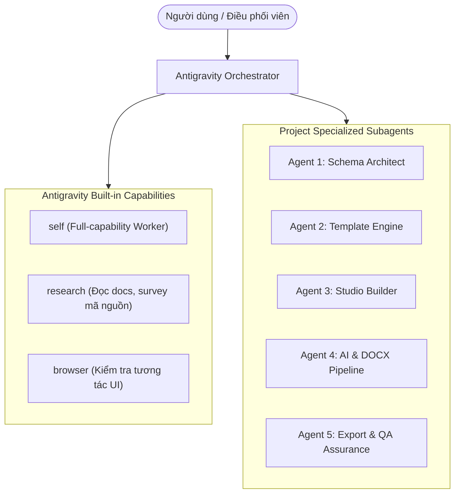

# BẢN BÀN GIAO TOÀN DIỆN DỰ ÁN (PROJECT HANDOVER SPECIFICATION)
> **Dự án**: AI Portfolio Factory (Production Ready)  
> **Thư mục làm việc**: `e:\Vibe code\Porfollio`  
> **Trạng thái cập nhật 12/11/2026**: Production build thành công, TypeScript pass. E2E riêng cho tiêu đề Projects, email Contact, tag Hero và thẻ thông tin bài tập đã pass; bộ test 7C vẫn dừng sớm ở assertion họa tiết Projects (`data-section-motif` vẫn là `none`), nên chưa xác nhận toàn bộ E2E. Không dùng trạng thái 10/10 E2E cũ làm kết quả hiện tại.  
> **Ngày lập**: 12/11/2026

---

## 1. Hướng dẫn dành cho AI mới tiếp quản (Quickstart for Next AI)

Khi một AI mới được đưa vào thư mục này, AI chỉ cần đọc tài liệu này và làm theo các bước sau để tiếp tục phát triển mà không bị mất ngữ cảnh:

1. **Khởi chạy môi trường kiểm tra**:
   ```powershell
   # Typecheck toàn bộ dự án
   npx.cmd tsc --noEmit
   # Build production
   npm.cmd run build
   # Chạy test E2E xác nhận tính toàn vẹn (cần bật next dev ở background trước)
   npm.cmd run test:e2e
   ```
2. **Khởi động server ứng dụng**:
   ```powershell
   npm.cmd run dev
   # Ứng dụng chạy tại: http://localhost:3000
   ```
3. **Các trang quan trọng**:
   - Studio Canvas: `http://localhost:3000/studio`
   - Batch Ingestion & Packager: `http://localhost:3000/batch`
   - Public Showcase Mẫu: `http://localhost:3000/thu-trang`, `http://localhost:3000/hq`, `http://localhost:3000/tuthivananhportfolio`

---

## 2. Đường Dẫn Chi Tiết Của Các Subagents (Antigravity & Project Subagents)

Dự án kết hợp **5 Subagents chuyên trách của dự án (Project-level)** với **3 Subagents tích hợp sẵn của Antigravity (Built-in Agents)**:



### Bảng Chi Tiết & Đường Dẫn Subagents:

| Subagent | Đường dẫn File Đặc tả / System Prompt | File mã nguồn trọng tâm (Source Code Paths) | Nhiệm vụ chính |
| :--- | :--- | :--- | :--- |
| **Agent 1: Schema Architect** | • [01_agent_1_template_extractor_schema_architect.md](file:///e:/Vibe%20code/Porfollio/Rule/01_agent_1_template_extractor_schema_architect.md)<br/>• [agent.md](file:///C:/Users/Admin/.gemini/antigravity/brain/945f9ddf-6cf8-43db-b73a-bd225a26720e/.agents/agents/agent-1-schema-architect/agent.md) | • [portfolio.schema.ts](file:///e:/Vibe%20code/Porfollio/src/schema/portfolio.schema.ts)<br/>• [theme.schema.ts](file:///e:/Vibe%20code/Porfollio/src/schema/theme.schema.ts)<br/>• [usePortfolioStore.ts](file:///e:/Vibe%20code/Porfollio/src/store/usePortfolioStore.ts) | Bảo vệ Single Source of Truth của Zod schema; quản lý state Zustand cho việc đổi bố cục, đảo vị trí, thêm bớt biến thể. |
| **Agent 2: Template Engine** | • [02_agent_2_modular_template_engine_visual_block_library.md](file:///e:/Vibe%20code/Porfollio/Rule/02_agent_2_modular_template_engine_visual_block_library.md)<br/>• [agent.md](file:///C:/Users/Admin/.gemini/antigravity/brain/945f9ddf-6cf8-43db-b73a-bd225a26720e/.agents/agents/agent-2-template-engine/agent.md) | • [HeroBlock.tsx](file:///e:/Vibe%20code/Porfollio/src/templates/blocks/HeroBlock.tsx)<br/>• [AboutBlock.tsx](file:///e:/Vibe%20code/Porfollio/src/templates/blocks/AboutBlock.tsx)<br/>• [ProjectsShowcaseBlock.tsx](file:///e:/Vibe%20code/Porfollio/src/templates/blocks/ProjectsShowcaseBlock.tsx)<br/>• [ContactBlock.tsx](file:///e:/Vibe%20code/Porfollio/src/templates/blocks/ContactBlock.tsx)<br/>• [TemplateShell.tsx](file:///e:/Vibe%20code/Porfollio/src/templates/archetypes/TemplateShell.tsx) | Triển khai 6 phong cách Canva (`canva-editorial`, `creative-bold`, `minimal-chic`, `vibrant-student`, `artistic-organic`, `academic-presentation`). |
| **Agent 3: Studio Builder** | • [03_agent_3_visual_studio_builder_theme_customizer_ui.md](file:///e:/Vibe%20code/Porfollio/Rule/03_agent_3_visual_studio_builder_theme_customizer_ui.md)<br/>• [agent.md](file:///C:/Users/Admin/.gemini/antigravity/brain/945f9ddf-6cf8-43db-b73a-bd225a26720e/.agents/agents/agent-3-studio-builder/agent.md) | • [SectionInspector.tsx](file:///e:/Vibe%20code/Porfollio/src/components/studio/SectionInspector.tsx)<br/>• [ThemeCustomizer.tsx](file:///e:/Vibe%20code/Porfollio/src/components/studio/ThemeCustomizer.tsx)<br/>• [AvatarFrame.tsx](file:///e:/Vibe%20code/Porfollio/src/components/visual-primitives/AvatarFrame.tsx)<br/>• [InlineEditableText.tsx](file:///e:/Vibe%20code/Porfollio/src/components/studio/InlineEditableText.tsx) | Phụ trách giao diện Studio, kéo thả (@dnd-kit) thẻ thông tin, đổi layout từng section, upload chân dung và khung viền. |
| **Agent 4: AI & DOCX Pipeline** | • [04_agent_4_ai_content_generator_vision_cloner_mass_production_engine.md](file:///e:/Vibe%20code/Porfollio/Rule/04_agent_4_ai_content_generator_vision_cloner_mass_production_engine.md)<br/>• [agent.md](file:///C:/Users/Admin/.gemini/antigravity/brain/945f9ddf-6cf8-43db-b73a-bd225a26720e/.agents/agents/agent-4-ai-docx-pipeline/agent.md) | • [docx-parser.ts](file:///e:/Vibe%20code/Porfollio/src/services/docx/docx-parser.ts)<br/>• [gemini-service.ts](file:///e:/Vibe%20code/Porfollio/src/services/ai/gemini-service.ts)<br/>• [route.ts (DOCX Ingest)](file:///e:/Vibe%20code/Porfollio/src/app/api/docx-ingest/route.ts) | Xử lý bóc tách file DOCX bài tập, tóm tắt tự động bài học, sinh ảnh AI minh họa bài giảng. |
| **Agent 5: Export & QA Assurance** | • [05_agent_5_publisher_static_exporter_automated_qa.md](file:///e:/Vibe%20code/Porfollio/Rule/05_agent_5_publisher_static_exporter_automated_qa.md)<br/>• [agent.md](file:///C:/Users/Admin/.gemini/antigravity/brain/945f9ddf-6cf8-43db-b73a-bd225a26720e/.agents/agents/agent-5-export-qa/agent.md) | • [zip-exporter.ts](file:///e:/Vibe%20code/Porfollio/src/services/export/zip-exporter.ts)<br/>• [portfolio-factory.spec.ts](file:///e:/Vibe%20code/Porfollio/tests/portfolio-factory.spec.ts) | Đóng gói ZIP độc lập chạy offline (HTML/CSS thuần + assets) và duy trì bộ kiểm thử tự động 10/10 test case. |

---

## 3. Quy trình Gọi Subagent trong Antigravity (Invocation Reference)

Khi AI tiếp quản cần phân chia công việc cho subagent thông qua lệnh `invoke_subagent`, sử dụng mẫu gọi sau:

```typescript
// Ví dụ: Gọi Agent 3 sửa đổi phần Studio Drag & Drop
invoke_subagent({
  TypeName: "agent-3-studio-builder",
  Role: "Studio Builder UI Specialist",
  Prompt: "Nhiệm vụ: Cập nhật component @dnd-kit trong SectionInspector và AboutBlock. Tham khảo tài liệu tại Rule/03_agent_3_visual_studio_builder_theme_customizer_ui.md"
});
```

---

## 4. Các quy tắc quan trọng cần tuân thủ (Rules for Next AI)

1. **Windows PowerShell Commands**:
   - Luôn sử dụng đuôi `.cmd` khi gọi CLI trên Windows: `npx.cmd`, `npm.cmd`, `node.cmd`.
2. **Quản lý cổng 3000**:
   - Trước khi build hoặc chạy kiểm thử đơn lẻ, kiểm tra và giải phóng cổng 3000:
     `Get-NetTCPConnection -LocalPort 3000 -ErrorAction SilentlyContinue | Where-Object { $_.State -eq 'Listen' } | ForEach-Object { Stop-Process -Id $_.OwningProcess -Force }`
3. **Tiêu chí Đề thi INF2501 (Rubric Compliance)**:
   - Phần **About**: Có các mục tiêu học phần (`Mục tiêu học tập & phát triển (INF2501)`) và mục tiêu portfolio; không hiển thị video giới thiệu bản thân.
   - Phần **Projects**: Chi tiết bài tập phải đủ 3 phần (Mục tiêu bài học, Ý tưởng sư phạm, Sản phẩm & Công cụ).
   - Phần **Contact**: Hiển thị lời cảm ơn và thông tin học phần tại footer; không hiển thị bảng kê khai công cụ AI.
4. **Selector Playwright không được phá vỡ**:
   - Không được xóa các `id` chuẩn: `#hero`, `#about`, `#projects`, `#contact`.
   - Giữ nguyên các test id: `data-testid="swap-about-layout"`, `data-testid="avatar-portrait-image"`, v.v.

---

## 5. Cập nhật gần nhất (12/11/2026)

- Thanh điều hướng và tiêu đề hiển thị bên trong Section cùng lấy từ `section.title` người dùng nhập; nếu rỗng, nhãn điều hướng quay về mặc định theo loại Section. Logic nhãn nằm trong `src/templates/archetypes/TemplateShell.tsx`; các block nội dung cũng render `section.title`.
- Section Projects trước đây thiếu trường chỉnh sửa tiêu đề trong Studio; đã thêm ô `Tiêu đề mục` để đổi toàn bộ heading như “Project • 06 Bài Tập Thực Hành”, đồng thời cập nhật nhãn điều hướng.
- Phần Footer trong Studio cho phép sửa tên hiển thị, căn trái/giữa/phải, ngành/chức danh và tên trường. Tên và ngành/chức danh đồng bộ với hồ sơ chủ nhân và Hero; tên trường lưu trong `ContactSection.courseInfo.institution` để hiển thị trên trang và ZIP export.
- Email hiển thị tại Contact có thể sửa trong Inspector; email được cập nhật tại `AboutSection.contactInfo.email`, là nguồn dùng chung cho nút mailto trên trang và ZIP export.
- Tags từng bài tập có thể sửa, thêm và xóa trong Inspector; cập nhật `ProjectItem.tags` để đồng bộ lên thẻ bài tập và trang chi tiết.
- Tag nhanh Hero có thể sửa trực tiếp trên canvas; trong chế độ Studio có nút thêm/xóa ngay cạnh các tag. Kết quả & điểm nhấn (`keyTakeaways`) và thẻ thông tin (`metrics`, ví dụ Quy trình/Công cụ) của bài tập đều hỗ trợ chỉnh sửa, thêm và xóa.
- Khi cập nhật tên, vị trí tên, MSSV hoặc lớp, giữ nguyên tên trường đã nhập; không ghi đè bằng giá trị mặc định.
- Các thay đổi Studio ở `src/components/studio/SectionInspector.tsx`; schema footer ở `src/schema/portfolio.schema.ts`; hiển thị và ZIP export ở `src/templates/blocks/ContactBlock.tsx` và `src/services/export/zip-exporter.ts`.
- Xác minh gần nhất: `npx.cmd tsc --noEmit` và `npm.cmd run build` thành công; E2E `Projects section title updates its heading and navigation label`, `Contact email is editable and updates its displayed mail link`, `Project tags can be edited, added, and removed`, `Project information chips can be edited, added, and removed`, và test Hero tags đều pass. Test thẻ thông tin báo pass nhưng Playwright runner treo trong teardown và đã được dừng sau khi assertion hoàn tất. E2E Test 7C vẫn chưa tới phần kiểm tra Footer do lỗi assertion họa tiết Projects; chưa tuyên bố toàn bộ E2E đạt.
